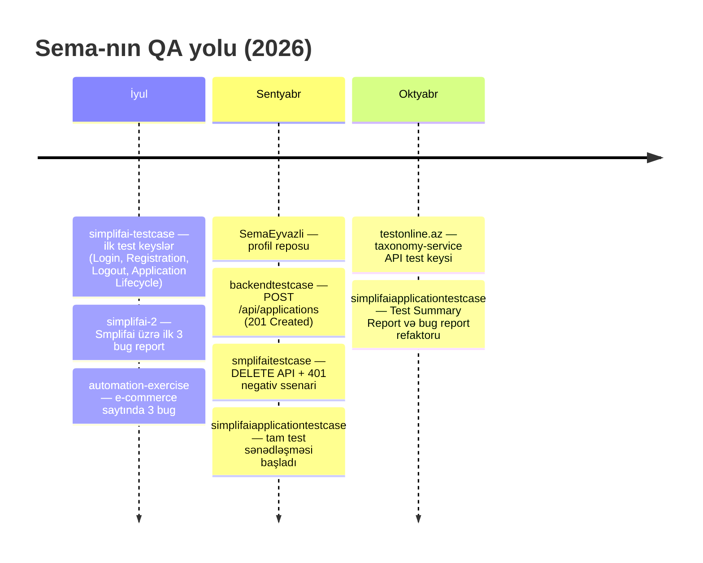

<!-- ============ HEADER ============ -->
<p align="center">
  
</p>

<p align="center">
  <a href="https://github.com/SemaEyvazli">
    
  </a>
</p>

<p align="center">
  
  
  
  
</p>

<p align="center">
  
</p>

---

## 👩‍💻 Haqqımda

Mən **Sonic Academy**-nin **QA Manual** proqramını (**İyul – Oktyabr 2026**) bitirmiş, real layihələr üzərində təcrübə qazanmış Manual QA mütəxəssisiyəm.
Təlim-təcrübə proqramı çərçivəsində iki canlı məhsulu test etmişəm:

| | Layihə | Nədir | Mənim işim |
|:-:|---|---|---|
| 🎓 | **Smplifai** | Tələbə qeydiyyatı və sənəd avtomatlaşdırma platforması (React + Node.js + Supabase) | Test Plan, Test Case, Checklist, Bug Report, Test Summary Report, UI + API (Swagger/Postman) testləri |
| 📝 | **OnlineTest (onlinetest.az)** | Azərbaycan şagirdləri üçün onlayn imtahan hazırlıq platforması (mikroservis arxitekturası) | `taxonomy-service` üzərində API test keysləri (Swagger UI, API Gateway) |
| 🛒 | **Automation Exercise** | Açıq demo e-commerce saytı | Kəşfiyyat (exploratory) testi və bug reportlar |

> 💡 *"Quality is never an accident; it is always the result of intelligent effort."*

---

## 📖 Repo Story — QA səyahətim

Hər repo bu yolun bir mərhələsidir. Commit tarixçəsinə əsasən xronologiya:



<details open>
<summary><b>🟢 Fəsil 1 — İlk addımlar (İyul)</b></summary>

<br>

**📁 [`simplifai-testcase`](https://github.com/SemaEyvazli/simplifai-testcase)**
Smplifai-nin tələb sənədindəki (business requirements) bölmələrə əsasən ilk cədvəl formatlı test keyslər yazıldı:
`2.1 Authentication & System Access` (Log In, Student Registration, Logout) və `2.4 Application Lifecycle` (Completeness Tracking). Hər keysdə Pre-conditions, Steps, Test Data, Expected Result və Status sütunları var.

**📁 [`simplifai-2`](https://github.com/SemaEyvazli/simplifai-2)**
Smplifai-də tapılan ilk 3 real xəta sənədləşdirildi:

| ID | Xəta | Modul | Severity |
|---|---|---|:-:|
| BUG-001 | Şifrə sıfırlama e-poçtu istifadəçiyə çatmır | Password Reset | 🔴 High |
| BUG-002 | Profil şəkli logout → login sonrası silinir | Profile | 🟠 Medium |
| BUG-003 | Mobil cihazda düymə və panellər ekrandan çıxır | Mobile UI | 🔴 High |

**📁 [`automation-exercise`](https://github.com/SemaEyvazli/automation-exercise)**
Açıq demo saytda kəşfiyyat testi — sərhəd dəyərləri və validasiya xətaları:

| ID | Xəta | Texnika |
|---|---|---|
| BUG-001 | Səbətə **mənfi sayda** (-1) məhsul əlavə etmək mümkündür | Boundary Value Analysis |
| BUG-002 | "Contact Us" **yanlış formatlı e-poçtu** qəbul edir | Negative / Validation testing |
| BUG-003 | Çoxlu simvolla axtarışda boş səhifə, "nəticə tapılmadı" mesajı yoxdur | Error Guessing |

</details>

<details open>
<summary><b>🔵 Fəsil 2 — API dünyasına keçid (Sentyabr)</b></summary>

<br>

**📁 [`backendtestcase`](https://github.com/SemaEyvazli/backendtestcase)** — `TC_APP_POST_001`
Bearer Token ilə `POST /api/applications` sorğusu → **`201 Created`**, cavab JSON-da obyektin `DRAFT` statusunda yaradıldığı yoxlanır.

**📁 [`smplifaitestcase`](https://github.com/SemaEyvazli/smplifaitestcase)** — `TC_APP_DEL_001`
End-to-end ssenari: UI-da müraciət yarat → Swagger-də **Authorize** → `DELETE /api/applications/{id}` → **`200 OK`**.
Negativ ssenari: token olmadan sorğu → **`401 Unauthorized`** (`"success": false`).

</details>

<details open>
<summary><b>🟣 Fəsil 3 — Tam QA sənəd paketi (Sentyabr → Oktyabr)</b></summary>

<br>

**📁 [`simplifaiapplicationtestcase`](https://github.com/SemaEyvazli/simplifaiapplicationtestcase)** ⭐ *əsas portfolio layihəsi — 16 commit*

| Sənəd | Məzmun |
|---|---|
| 📋 `README.md` — **Test Plan** | Objective, In/Out of Scope, Test Types, Environment, Entry/Exit Criteria, Risks & Mitigation, Deliverables |
| 🧪 `test-cases.md` | 6 test keys: UI (My Application, Sign In) + API (GET, DELETE, 401 Unauthorized, 404 Not Found) |
| ✅ `Checklist.md` | 4 bölmə: Authentication, Application & File Upload, API Testing, UI/UX & Responsiveness |
| 🐞 `bug-reports.md` | 3 bug — Steps to Reproduce, Actual/Expected, Severity/Priority |
| 📊 `Test-Summary-Report.md` | Metrikalar, bug paylanması, yekun QA statusu |

```text
┌────────────── Test Execution Summary ──────────────┐
│  Total Test Cases ........ 4                       │
│  ✅ Passed ................ 3                       │
│  ❌ Failed ................ 1                       │
│  ⛔ Blocked ............... 0                       │
│  🐞 Bugs Found ............ 3  (High: 2, Medium: 1) │
│  Final Status ............ Conditional Approval    │
└────────────────────────────────────────────────────┘
```

**📁 [`testonline.az`](https://github.com/SemaEyvazli/testonline.az)**
OnlineTest platformasının mikroservis arxitekturasında **API Gateway → Swagger UI → `taxonomy-service`** seçimi ilə `POST /api/v1/exam-definitions` endpoint-i üzərindən yeni imtahan növünün ("Buraxılış imtahanı", 85 sual, 180 dəq, 300 bal) yaradılması test edildi → **Passed** ✅

</details>

---

## 📊 Rəqəmlərlə

<p align="center">
  
  
  
  
  
  
</p>

<p align="center">
  
  
</p>

---

## 🎓 Sonic Academy — QA Manual (İyul – Oktyabr 2026)

<details open>
<summary><b>📚 Öyrənilən mövzular</b></summary>

<br>

| # | Modul | Mövzular |
|:-:|---|---|
| 1 | 🧭 **Testing əsasları** | QA vs QC vs Testing, Error / Defect / Bug / Failure, 7 test prinsipi, testin məqsədi və dəyəri |
| 2 | 🔄 **SDLC & STLC** | Waterfall, V-Model, Iterative, Agile; STLC mərhələləri (Requirement Analysis → Test Planning → Test Design → Environment Setup → Execution → Closure) |
| 3 | 🏃 **Agile & Scrum** | Rollar (PO, SM, Dev Team), Sprint, Backlog, User Story, Acceptance Criteria, Definition of Done, Daily/Review/Retro, Kanban |
| 4 | 🏗️ **Test səviyyələri** | Unit, Integration, System, Acceptance (UAT, Alpha/Beta) |
| 5 | 🧪 **Test növləri** | Functional / Non-functional, Smoke, Sanity, Regression, Retesting, Exploratory, Ad-hoc, Usability, Compatibility, Cross-browser, Security əsasları, Performance anlayışı |
| 6 | 📦 **Black / White / Grey Box** | Testing yanaşmaları və fərqləri, Static vs Dynamic testing, Review növləri |
| 7 | 🎯 **Test Design texnikaları** | Equivalence Partitioning, Boundary Value Analysis, Decision Table, State Transition, Use Case testing, Error Guessing, Pairwise |
| 8 | 📝 **Test sənədləşməsi** | Test Plan, Test Strategy, Test Scenario, Test Case, Checklist, Test Data, RTM (Requirement Traceability Matrix), Test Summary Report |
| 9 | 🐞 **Bug Management** | Bug Report strukturu, Severity vs Priority, Bug Life Cycle (New → Assigned → Open → Fixed → Retest → Verified → Closed / Reopened / Rejected / Deferred) |
| 10 | 🌐 **Web testing** | Client-Server, HTTP/HTTPS, URL quruluşu, Cookies / Session / Cache, Local & Session Storage, Responsive testing |
| 11 | 🛠️ **Chrome DevTools** | Elements, Console, Network (request/response, status kodlar), Application tab, device emulation |
| 12 | 🔌 **API Testing** | REST, HTTP metodları (GET, POST, PUT, PATCH, DELETE), Status kodlar (2xx/4xx/5xx), Headers, JSON, Query/Path params, Bearer Token autentifikasiya, pozitiv/negativ API ssenariləri |
| 13 | 📮 **Postman & Swagger** | Collection, Environment, Variables, Authorization, Swagger UI ilə endpoint test, API sənədləşməsini oxumaq |
| 14 | 🧩 **Mikroservis anlayışı** | API Gateway, servislərin ayrılması, staging mühit |
| 15 | 📱 **Mobile testing** | Android/iOS fərqləri, real cihaz vs emulator, responsive UI yoxlamaları |
| 16 | 🗄️ **SQL əsasları** | SELECT, WHERE, JOIN, ORDER BY, GROUP BY — backend data yoxlaması |
| 17 | 📋 **Jira** | Project, Issue types (Epic, Story, Task, Bug), Workflow, Board, Sprint, Filters |
| 18 | 🐙 **Git & GitHub** | Repository, commit, push, Markdown ilə QA sənədləşməsi, portfolio qurmaq |
| 19 | 💼 **Karyera hazırlığı** | CV, LinkedIn, GitHub portfolio, texniki müsahibə sualları |

</details>

---

## 🧰 Alətlər & Texnologiyalar

<p align="center">
  <a href="https://skillicons.dev">
    
  </a>
</p>

<p align="center">
  
  
  
  
  
  
  
  
  
  
  
  
</p>

| Sahə | Alət |
|---|---|
| 📋 Test & Bug idarəetməsi | Jira, GitHub Markdown, Google Sheets |
| 🔌 API Testing | Postman, Swagger UI |
| 🌐 Web / UI Testing | Google Chrome, Chrome DevTools, Responsive (device) mode |
| 📱 Mobile Testing | Chrome Mobile (Android) |
| 🗄️ Data | SQL |
| 🐙 Versiya nəzarəti | Git, GitHub |
| ✍️ Sənədləşmə | Markdown, VS Code |

---

## 🗂️ Repozitoriyalar

| Repo | Layihə | Növ | Status |
|---|---|---|:-:|
| ⭐ [simplifaiapplicationtestcase](https://github.com/SemaEyvazli/simplifaiapplicationtestcase) | Smplifai | Test Plan · Test Cases · Checklist · Bug Reports · Summary Report |  |
| [testonline.az](https://github.com/SemaEyvazli/testonline.az) | OnlineTest | API Test Case (taxonomy-service) |  |
| [smplifaitestcase](https://github.com/SemaEyvazli/smplifaitestcase) | Smplifai | API Test Case — DELETE + 401 |  |
| [backendtestcase](https://github.com/SemaEyvazli/backendtestcase) | Smplifai | API Test Case — POST 201 |  |
| [simplifai-2](https://github.com/SemaEyvazli/simplifai-2) | Smplifai | Bug Reports (3) |  |
| [simplifai-testcase](https://github.com/SemaEyvazli/simplifai-testcase) | Smplifai | Functional Test Cases |  |
| [automation-exercise](https://github.com/SemaEyvazli/automation-exercise) | Automation Exercise | Bug Reports (3) |  |

---

## 💪 Bacarıqlar

```text
Test Case Design        ██████████████████░░  90%
Bug Reporting           ██████████████████░░  90%
Test Documentation      █████████████████░░░  85%
API Testing (Postman)   ████████████████░░░░  80%
Swagger UI              ████████████████░░░░  80%
UI / Mobile Testing     ████████████████░░░░  80%
Jira / Agile            ███████████████░░░░░  75%
SQL                     ████████████░░░░░░░░  60%
```

---

## 🎯 Növbəti hədəflər

- [ ] Postman Collection + Environment ilə avtomatlaşdırılmış API test dəsti
- [ ] Postman `pm.test()` skriptləri ilə response validasiyası
- [ ] SQL ilə backend data yoxlaması (DB-level verification)
- [ ] QA Automation (Selenium / Playwright) öyrənmək
- [ ] ISTQB Foundation Level sertifikatı

---

## 📫 Əlaqə

<p align="center">
  <a href="https://github.com/SemaEyvazli"></a>
</p>

<p align="center">
  
</p>

<p align="center">
  
</p>
